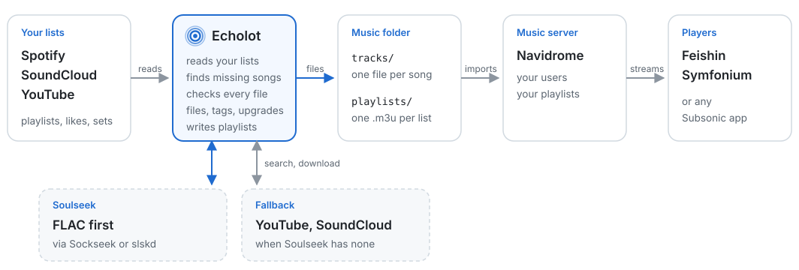

<p align="center">
  <picture>
    <source media="(prefers-color-scheme: dark)" srcset="docs/banner-dark.svg">
    
  </picture>
</p>

Echolot turns your playlists and likes on Spotify and SoundCloud, and your YouTube playlists, into an eternal
music archive on your own server. Every song as the right recording, in the best quality it can find.

It is made for people who want a clean library they can rely on. Echolot would rather leave a song missing
than file a wrong recording or a broken file. Lossy copies, fake FLACs included, are labelled as what they
are and replaced once a genuine FLAC turns up.

<p align="center">
  
</p>

## What it does

- **Follows your lists.** Spotify playlists and liked songs, SoundCloud likes and sets, YouTube playlists.
  New songs arrive within minutes.
- **Finds every song.** On Soulseek, YouTube and SoundCloud, FLAC first. It also gets free downloads from
  Bandcamp and Hypeddit, takes files you upload, and can record songs from Spotify with
  [Mitschnitt](https://github.com/Zweisteinium/mitschnitt).
- **Checks every file.** Artist, title, version and length have to match, and the audio is compared with the
  official release. Damaged files are rejected, fake FLACs are recognised as lossy. When Echolot is unsure,
  you decide on the Review page.
- **Gets better over time.** Lossy songs keep being searched for FLAC. A genuine FLAC replaces the lossy
  copy.
- **Keeps what disappears.** Songs taken down on Spotify or SoundCloud stay in your library.
- **Plays everywhere.** Every list becomes a playlist in [Navidrome](https://www.navidrome.org), with your likes
  and the lyrics, for each user. Any Subsonic app plays it on your phone or computer.

Echolot does not recommend music. Keep your streaming service for finding new songs. For the ones you already
know, Echolot covers everyday listening.

## Get started

You need:

- Docker with Compose.
- A music folder that belongs to you, with room: a song in FLAC takes about 30 MB, so 10,000 songs take
  about 300 GB.
- For Spotify lists, one Premium account to create Echolot's Spotify app with. Up to five people can use it.

Navidrome comes with it, or use your own. Everyone logs in to Echolot with their Navidrome account.
Soulseek shows your IP address to other users. To hide it behind a VPN, set that up first (see Setups).

```sh
mkdir echolot && cd echolot
curl -fsSLO https://raw.githubusercontent.com/Zweisteinium/echolot/main/deploy/compose.yaml
curl -fsSL https://raw.githubusercontent.com/Zweisteinium/echolot/main/deploy/.env.example -o .env
nano .env    # set MUSIC to your music folder, and PUID and PGID to yours (id -u, id -g)
mkdir -p data/echolot data/sockseek data/navidrome
docker compose up -d
```

Create the first account in Navidrome at `http://<host>:4533`, then log in to Echolot at `http://<host>:8490`
with it. Echolot asks to use that account to give each playlist to its user, and it creates a Soulseek
account by itself.

> **Status:** beta. Echolot runs every day on a library of over 15,000 songs. Expect the odd rough edge until 1.0.

---

The rest of this page goes into detail: accounts, other setups, how Echolot decides, configuration and
development.

## More features

| Feature | What it does |
|---|---|
| Review | Doubtful downloads with a player and the reason, answered with a click or a key. |
| Missing | The songs not found yet, and those that seem wiped off the internet. Upload a file for one and see how it checks out before you import it. |
| Unreleased music | A friend's songs or an edit deleted everywhere, the audio untouched, in lists of their own. |
| Buy | Lossy SoundCloud songs whose page links to Bandcamp, with the price. Free Bandcamp downloads come in by themselves, Hypeddit ones with one click. |
| Lyrics | From [LRCLIB](https://lrclib.net), synced where available, only when they surely belong to the song. |
| Statistics | Growth over time and quality by file, song and list. Prometheus metrics and an API. |
| Users | Everyone logs in with their Navidrome account and gets their own lists, playlists and likes. |
| Discogs | Optional. The releases of your songs that Discogs lacks, with what to submit for them. |

## What it doesn't do

- It doesn't recommend music.
- It never changes your lists on Spotify, SoundCloud or YouTube. It only reads them.
- It keeps songs, not albums.
- It doesn't break copy protection.

If you are after discovery and album management, [SoulSync](https://github.com/Nezreka/SoulSync) does much of
what Echolot does and more. The two run fine side by side.

## Roadmap

| Status | Plan | |
|---|---|---|
| In progress | Genre and BPM from the audio | Tags are often missing or wrong, Spotify's too. A genre that just says "Music" helps nobody. A custom pipeline on the audio models MAEST and EffNet works them out from the sound itself. Its benchmark, genre-bench, is private, access on request. |
| Next | Existing libraries | A good way to bring a library you already have, read-only beside Echolot or fully managed by it. |
| Next | More lyrics | Coverage is still quite low. |
| Later | More platforms | YouTube Music, Apple Music, Tidal and Deezer. |
| Later | More music servers | Navidrome fits this stack best. Plex or Jellyfin would need a lot of compatibility work. |

Later comes sooner if someone asks nicely.

## Accounts

**Spotify.** One person creates a developer app with a Premium account. It is free and takes two minutes,
and the Playlists page has the steps. The app stops working when that Premium ends. Others need no
Premium: the app's owner adds their Spotify accounts in the app's User Management, up to five. Spotify's
own playlists (This Is, editorial) are read from their public page, which may cut a long one short.
Playlists by other people may be withheld by Spotify. Copy their songs into a playlist of yours. See
Spotify's [quota modes](https://developer.spotify.com/documentation/web-api/concepts/quota-modes) for the
limits.

**SoundCloud.** SoundCloud hands out no app keys, so Echolot uses two cookies of a browser login. The
Playlists page shows where to find them. Log in from a private window and close it without logging out.
Echolot then renews the login every day.

**YouTube.** Nothing to connect. Follow a playlist by its link.

## Setups

<details>
<summary><b>With a Navidrome you already run</b></summary>

Set `NAVIDROME_URL` in `.env` and remove the `navidrome` service from `compose.yaml`. Give Echolot its own
folder inside Navidrome's music folder, for example `MUSIC=/srv/music/echolot` when Navidrome reads
`/srv/music`. Echolot puts a `.ndignore` into its `inbox/`, so Navidrome skips the downloads. With Navidrome
0.58 or later you can add that folder as a second library instead.

Navidrome has to import playlists (`ND_AUTOIMPORTPLAYLISTS`, on by default). It imports them all as its
first admin's, and Echolot then hands each one to its user. It never touches playlists it didn't write.

For the hearts, Navidrome has to let Echolot act as each user. Set `ND_EXTAUTH_USERHEADER=X-Echolot-User`
and `ND_EXTAUTH_TRUSTEDSOURCES` to Echolot's address as Navidrome sees it, and nothing else. Never trust
the address of a reverse proxy or a Docker gateway there, because other people's requests come from it
too. Put both on a Docker network of their own with Echolot at a fixed address, as the bundled
`compose.yaml` does.

Songs you already have in your own library will show up twice.
</details>

<details>
<summary><b>With a music library you already have</b></summary>

Give Echolot a folder of its own and let it be the only one writing there. It only understands
`tracks/<Artist>/<Artist> - <Title>.<ext>`. A library in another layout is invisible to it, so everything
would be downloaded again. In its own layout it replaces files with better copies and renames them. Both
folders can go into the same Navidrome.
</details>

<details>
<summary><b>Soulseek through a VPN</b></summary>

Soulseek peers see your IP address. Put `vpn.yaml` next to `compose.yaml`
(`curl -fsSLO https://raw.githubusercontent.com/Zweisteinium/echolot/main/deploy/vpn.yaml`), fill in the VPN lines and `COMPOSE_FILE` in `.env`, and
start as usual. [gluetun](https://github.com/qdm12/gluetun) then carries the Soulseek traffic. YouTube and SoundCloud stay on your own connection, as they don't like VPNs.
With a provider that forwards a port, peers behind a firewall can send to you too.
</details>

<details>
<summary><b>slskd as the Soulseek client</b></summary>

[slskd](https://github.com/slskd/slskd) is a full Soulseek client. It shares, so fewer peers turn you
down. In **Server settings → Soulseek**, choose slskd and enter its address, its web login or an API key,
and its downloads folder as Echolot sees it. Two things matter:

- The downloads folder has to be on Echolot's music volume. `MUSIC/inbox/slskd` is a good place.
- slskd has to run as Echolot's user (`user: "1000:1000"`, your `PUID:PGID`), or Echolot can't move the
  files it downloads.

Share some music in slskd. Echolot's `tracks/`, read-only, does the job. The bundled daemon is then
unused.
</details>

<details>
<summary><b>Behind a reverse proxy</b></summary>

Set `FORWARDED_ALLOW_IPS` in `.env` to the proxy's address, so Echolot trusts the proxy's headers. Over
https, the Spotify login comes back to Echolot by itself. Over plain http you paste one address back, and the
Playlists page shows where.
</details>

<details>
<summary><b>Next to other services</b></summary>

| Service | Works next to Echolot if |
|---|---|
| slskd | it doesn't use the same Soulseek name as the daemon at the same time. Or let Echolot use slskd. |
| Lidarr, Soularr | they have their own root folder, never Echolot's `tracks/`. |
| beets | it stays out of Echolot's folder. It renames and retags, and Echolot finds songs by their names. |
| Jellyfin | you're fine with its playlists being shared. It imports the `.m3u` files for everyone with access. |
| Plex | you don't need the playlists. It reads `tracks/` but not `.m3u` files. |
| Subsonic apps | always, through Navidrome, each user with their own playlists. |
</details>

## How it works

<p align="center">
  <picture>
    <source media="(prefers-color-scheme: dark)" srcset="docs/how-it-works-dark.svg">
    
  </picture>
</p>

1. **Lists.** Echolot reads the lists you follow and keeps every song once. A song the library already has
   under another name is linked, not downloaded again.
2. **Search.** A missing song is searched on Soulseek. Every result is judged by its name and length before
   anything is downloaded. The best one is fetched, and the next one if it stalls. SoundCloud songs come
   straight from SoundCloud.
3. **Fallback.** What Soulseek doesn't have is searched on YouTube, the official audio first, then on
   SoundCloud. Songs found nowhere are tried again regularly, with looser terms after a few misses.
4. **Check.** Each download is repaired where needed. WAV, AIFF and ALAC become FLAC with the very same
   samples. FLAC above 48 kHz becomes 44.1 or 48 kHz at 24 bit, unless Server settings keeps hi-res. Then
   it is checked for being made from a lossy file, with a spectrum check and
   [lossprint](https://github.com/maxdjohnson/lossprint), and identified by name and by sound.
5. **File.** Into `tracks/<Artist>/`, tagged as the song in your list.
6. **Upgrade.** Lossy songs are searched again for FLAC, the longest waiting first. A new copy replaces the
   old one only if it is the same recording. A file from the artist's own free download or shop stays, even
   as an MP3.
7. **Keep.** Once a day, every song is checked at its source. Whatever was taken down stays in the archive.
8. **Playlists.** One `.m3u` per list, in list order, with its cover, in `playlists/<user>/`.

<details>
<summary><b>When is a file the song?</b></summary>

- **Same song:** the same artist (any of the song's artists, ignoring case, accents and punctuation), the
  same title once the noise is gone ("(Original Mix)", "(feat. X)", "[HAK003]", "- 2011 Remaster",
  "(Official Video)"), and a length within 10 s, or 4 % for songs over about four minutes. Version words
  (remix, edit, extended, VIP, live, a cappella, Pt. 2) and other featured artists keep songs apart. A cut
  from a DJ mix is the song at any length.
- **Before a download:** a result is skipped when it names another version or lacks the one asked for, has
  another song's length, was marked wrong before, or doesn't name the artist as a name of its own ("HK",
  not "HK Gruber").
- **After a download:** an exact match is filed. A probable one, the core title with the length within
  3 s (6 s from YouTube and SoundCloud), is filed too and listed on the Review page to confirm, unless all
  it adds is noise. The rest is rejected, and near misses wait for review.
- **The sound:** from 0.8 of the fingerprint in common with the release's preview, a download is the
  recording. Up to 0.7 it is another one, which sends even an exact name to review. A file tagged with the
  song's ISRC counts as the recording.
</details>

## Configuration

Echolot works out of the box, and every setting has a sensible default. Nearly all of them can be changed
in the web app under **Server settings**: each job's schedule, the Soulseek client and how many songs it
fetches at once, whether hi-res FLAC stays, logins and access. `echolot.yml` holds all lists and settings
in one file, for a second install. It holds no passwords or tokens, so back up `data/` as well. `.env` only
has the basics:

| Variable | Default | |
|---|---|---|
| `MUSIC` | required | your music folder |
| `PUID`, `PGID` | `1000` | the user and group the containers run as |
| `TZ` | `UTC` | your time zone, for the job times |
| `ECHOLOT_PORT`, `NAVIDROME_PORT` | `8490`, `4533` | the ports on the host |
| `NAVIDROME_URL` | the bundled one | your own Navidrome |
| `HEARTS_NET` | `10.253.53` | the network of Echolot and the bundled Navidrome (`.0/29`), if that one is taken |
| `VPN_*`, `WIREGUARD_PRIVATE_KEY`, `SERVER_COUNTRIES` | | only with `vpn.yaml`, see the [gluetun wiki](https://github.com/qdm12/gluetun-wiki) |

<details>
<summary><b>What the Echolot container reads</b></summary>

`compose.yaml` sets the first ones for you. Set others under the `echolot` service's `environment:` there.

| Variable | Default | |
|---|---|---|
| `ECHOLOT_LIBRARY_DIR` | `/music/tracks` | the library. It must end in `tracks`, with `inbox/` and `playlists/` next to it. |
| `ECHOLOT_DAEMON_DIR` | `/daemon` | where Echolot writes the Soulseek daemon's login |
| `ECHOLOT_NAVIDROME_URL` | `http://navidrome:4533` | Navidrome's address, unless Server settings has another |
| `ECHOLOT_DATA_DIR` | `/data` | the database and Echolot's own files |
| `ECHOLOT_SECRET_KEY`, `ECHOLOT_SECRET_KEY_FILE` | | the key for stored passwords and tokens. Without one, Echolot creates `secret.key` in its data folder, so a backup of `data/` holds both. Set it before the first start: a new key can't read what the old one stored. |
| `ECHOLOT_WORKER` | `on` | `off` runs no jobs, for a test copy |
| `ECHOLOT_LOSSPRINT` | `on` | `on`: lossprint and the spectrum check decide together on every FLAC. `off`: the spectrum check alone. |
| `ECHOLOT_HOST`, `ECHOLOT_PORT` | `0.0.0.0`, `8490` | where it listens inside the container. `ECHOLOT_PORT` in `.env` is the host's port. |
| `FORWARDED_ALLOW_IPS` | `127.0.0.1` | the reverse proxy whose `X-Forwarded-*` headers count |
</details>

## Running it

- **Jobs** run on their schedule from **Server settings**. The **Jobs** page starts, stops and pauses them.
- **History** lists everything filed and rejected. `docker compose logs echolot` has the details.
- **Users** are Navidrome's accounts. Navidrome admins are admins here too, and the **Users** page gives
  others more rights. Locked out: `docker compose exec echolot echolot user admin <name>`.
- **Backups:** `data/` next to `compose.yaml`, and your music folder. Echolot backs up its database before
  every update that changes it. Stop Echolot first for a clean copy of your own.
- **A music folder half gone**, such as a disk or share not mounted, is not taken as deleted. The library
  job fails and keeps the last scan until the files are back. If you removed that many files on purpose:
  `docker compose exec echolot echolot library rescan --accept-missing`.
- **Limits:** Soulseek allows about 34 searches every 220 seconds, so a long list takes a while.
- **Updates:** read the release notes, then:

```sh
curl -fsSLO https://raw.githubusercontent.com/Zweisteinium/echolot/main/deploy/compose.yaml    # or, if you changed yours, the versions in it
docker compose pull
docker compose up -d
```

<details>
<summary><b>The jobs and their defaults</b></summary>

| Job | Default | What it does |
|---|---|---|
| Spotify lists | every 3 min | reads the lists that changed. New songs start a search. |
| New songs search | after Spotify and YouTube lists | the library first, then Soulseek |
| New SoundCloud songs | every 5 min | reads the lists that changed and downloads new songs |
| YouTube lists | every 30 min | reads each playlist |
| YouTube & SoundCloud search | every 2 h | the fallback for songs Soulseek lacks |
| Missing songs | 20:00, weekends also 15:00 | Soulseek again for songs found nowhere |
| FLAC upgrade | 14:00 and 20:30 | FLAC-only searches for lossy songs |
| Availability check | 05:30 | whether your songs still play on Spotify and SoundCloud |
| Library upkeep | every 5 min | rescans the files, applies review decisions, writes the playlists |
| Lyrics | every 30 min | lyrics from LRCLIB for the files that have none yet, the newest first |
| FLAC upgrade for all songs, Covers, Lossy check | off | started by hand |
| Bandcamp offers | after New SoundCloud songs | a new song's Bandcamp offer and free downloads |
| Discogs check | off | started from the Discogs page |
</details>

## API and metrics

Scripts use an admin's API token from **Your account**: `Authorization: Bearer <token>`. `/api/docs`
describes the API.

| Endpoint | Returns |
|---|---|
| `GET /metrics` | the library, songs and lists for Prometheus, with a token or without one if Server settings allows it |
| `GET /api/stats`, `/api/stats/history?metric=…` | the latest hourly numbers, and one of them over time |
| `GET /api/stats/downloads?days=30` | filed and rejected per day, source and format |
| `GET /api/jobs`, `POST /jobs/<name>/run` | the jobs, and starting one |
| `GET /api/config`, `PUT /api/config` | everything as `echolot.yml` |

## Development

You need [uv](https://docs.astral.sh/uv/).

```sh
uv sync
uv run pytest
uv run ruff check
uv run ruff format
uv run echolot serve
```

The audio tests need ffmpeg, like the image. `echolot serve` listens on http://127.0.0.1:8490.

| `src/echolot/` | |
|---|---|
| `cli.py`, `config.py`, `db.py` | the command line, the environment, the database |
| `settings/` | settings, stored secrets, logins and tokens, the followed lists, `echolot.yml` |
| `services/` | Spotify, SoundCloud, YouTube, Bandcamp and free downloads, Discogs, Beatport, Navidrome, the Soulseek clients, yt-dlp |
| `library/` | the matching rules, the audio check, tags, the catalog, filing, review, uploads, recording, lyrics, playlists, statistics |
| `jobs/` | the worker and its schedule, finding songs, reading lists |
| `web/` | the pages and the API |

CI tests every push that changes code, and builds the image for amd64 and arm64 when what goes into it
changed. A new version in `pyproject.toml` and
`deploy/compose.yaml`, with its notes in `CHANGELOG.md`, is released when it lands on `main`. A test checks
all three. CI then tags it, publishes the release with those notes and pushes `lordlayer/echolot` to Docker
Hub for both platforms. The Sockseek daemon's image
(`deploy/sockseek`, `lordlayer/echolot-sockseek`) is built from a tested Sockseek commit and pushed from `main`
when that changes.

## Credits

- [Sockseek](https://github.com/fiso64/sockseek) by fiso64 searches and downloads on Soulseek for Echolot.
- [lossprint](https://github.com/maxdjohnson/lossprint) tells a FLAC made from an MP3, AAC or Opus file from a
  genuine one. After a lot of research and testing, it is by far the best tool for this that I have found.
- [Navidrome](https://www.navidrome.org) plays the library, and its accounts are Echolot's.

## Fair use

Echolot sorts, checks and de-duplicates audio files and keeps them in step with your lists. What you get
through the sources you connect is your responsibility. Use it for music you are entitled to, and stick to
the terms of those services and the law where you live. Echolot does not break copy protection.

## License

[GNU AGPL v3 or later](LICENSE)
